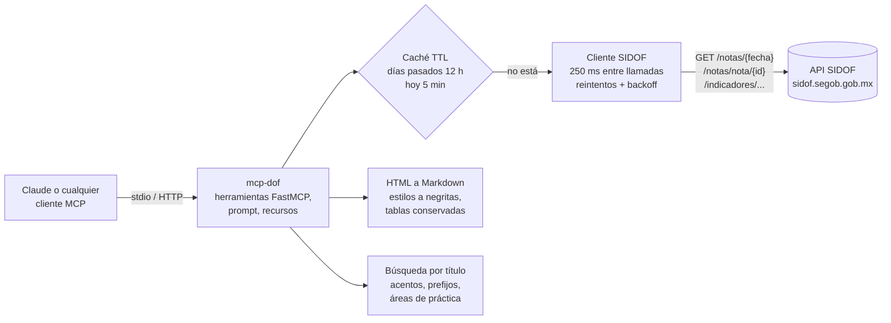

<p align="center">
  
</p>

<p align="center">
  <a href="README.md">English</a> · <b>Español</b>
</p>

<p align="center">
  <a href="https://github.com/BEG-lag/mcp-dof/actions/workflows/ci.yml"></a>
  
  
  
  <a href="https://registry.modelcontextprotocol.io/v0.1/servers?search=io.github.BEG-lag/mcp-dof"></a>
</p>

**mcp-dof** es un servidor [Model Context Protocol](https://modelcontextprotocol.io) que permite a
Claude y a otros agentes de IA leer el *Diario Oficial de la Federación* (DOF): qué se publicó
cualquier día, el texto íntegro de cada decreto, acuerdo o aviso en Markdown limpio, búsqueda por
título en rangos de fechas, y el tipo de cambio, las UDIS y la TIIE que el DOF publica a diario.

En el DOF la ley federal se vuelve ley. Abogados, áreas de cumplimiento y analistas lo revisan cada
mañana. Este servidor deja que un agente haga la lectura, siempre citando la liga oficial.

## Demo

Salida real, grabada con un cliente MCP real por stdio contra la API en vivo el 17-11-2026. Los
fragmentos se copiaron tal cual (`…` marca líneas omitidas); la transcripción completa y sin
editar está en [`docs/demo.md`](docs/demo.md). Las herramientas responden en inglés porque las
lee primero el modelo; los títulos y datos van tal como los publica el DOF.

```markdown
<!-- list_edition(date="2026-11-13") · 0.4 s -->
# DOF 2026-11-13 · Friday

66 notes in 2 edition(s): matutina, vespertina.
44 avisos judiciales y generales hidden (pass include_avisos=true to list them).

## Edición matutina · 61 notes (44 avisos hidden) · [edition PDF](https://sidof.segob.gob.mx/dof/sidof/documentos/pdf/330805)

**PODER EJECUTIVO › PRESIDENCIA DE LA REPUBLICA**
- `5803757` Decreto por el que se expide la Ley de Ingresos de la Federación para el Ejercicio Fiscal de 2027. · p. 4 · [DOF](https://dof.gob.mx/nota_detalle.php?codigo=5803757&fecha=13/11/2026)
…
```

```markdown
<!-- get_indicators(date="2026-11-17") · 0.2 s -->
| Indicator | Value | Unit | Published | Key |
| --- | --- | --- | --- | --- |
| Tipo de cambio FIX (dólar) | 18.5525 | MXN per USD | 2026-11-17 | `usd` |
| UDIS | 8.913896 | MXN per UDI | 2026-11-17 | `udis` |
| TIIE 28 días | 6.5147% | % annual | 2026-11-17 | `tiie28` |
| TIIE 91 días | 6.5492% | % annual | 2026-11-17 | `tiie91` |
| TIIE 182 días | 6.5995% | % annual | 2026-11-17 | `tiie182` |
| TIIE de fondeo | 6.26% | % annual | 2026-11-17 | `tiie_fondeo` |
…
```

`search_notes(practice_area="hidrocarburos", date_from="2026-10-01", date_to="2026-11-13")` revisó
44 días (535 notas) en 10.7 s con el caché vacío y devolvió 32 resultados, desde las disposiciones
de la CNE sobre comercialización de gas natural y petrolíferos hasta las NOM de emergencia de la
ASEA sobre gas LP.

Cosas que puedes pedir ya conectado (ejemplos de instrucciones, no respuestas grabadas):

- *"¿Qué publicó el DOF hoy? Resume solo lo que toca energía e hidrocarburos."*
- *"Lee la Ley de Ingresos 2027 y enlista cada artículo transitorio que tenga un plazo."*
- *"Prepara un digest regulatorio de minería de las últimas dos semanas."* (usa el prompt `regulatory_digest`)
- *"¿Cómo se movió el tipo de cambio FIX en octubre de 2026?"*

## Inicio rápido

Necesitas [uv](https://docs.astral.sh/uv/). Nada más: `uvx` descarga y corre el servidor.

**Claude Code**

```bash
claude mcp add dof -- uvx --from git+https://github.com/BEG-lag/mcp-dof mcp-dof
```

**Claude Desktop**: agrega esto a `claude_desktop_config.json`
(macOS: `~/Library/Application Support/Claude/`, Windows: `%APPDATA%\Claude\`) y reinicia:

```json
{
  "mcpServers": {
    "dof": {
      "command": "uvx",
      "args": ["--from", "git+https://github.com/BEG-lag/mcp-dof", "mcp-dof"]
    }
  }
}
```

**Docker**: cada versión publica una imagen multiarquitectura (linux/amd64, linux/arm64) en GitHub
Container Registry. En la configuración de cualquier cliente, usa `"command": "docker"` con estos
argumentos:

```bash
docker run -i --rm ghcr.io/beg-lag/mcp-dof:1.0.0
```

**Cualquier otro cliente MCP**: corre `mcp-dof` por stdio, o `mcp-dof --transport http --port 8000`
para HTTP en `http://127.0.0.1:8000/mcp`.

Los metadatos para el [MCP Registry](https://registry.modelcontextprotocol.io) están en
[`server.json`](server.json), con el nombre `io.github.BEG-lag/mcp-dof`.

## Herramientas

| Herramienta | Qué hace |
| --- | --- |
| `list_edition(date, edition, include_avisos)` | Sumario de un día (matutina, vespertina, extraordinaria), agrupado por dependencia, con código de nota, página, liga oficial y PDF de la edición. En fines de semana y días inhábiles indica la última edición. |
| `get_note(code, start, max_chars)` | Texto íntegro de una nota en Markdown (negritas, tablas y ligas incluidas) con su ficha de datos. Los instrumentos largos se paginan. |
| `search_notes(query, date_from, date_to, practice_area, edition, include_avisos, limit)` | Búsqueda por título en hasta 92 días, de lo más reciente a lo más antiguo, con avance en vivo. Ignora acentos y mayúsculas, busca por prefijo (`eléctric`), acepta `"frases"`, alternativas `a \| b` y siglas (`CFE`, `ISR`). |
| `get_indicators(date)` | Tipo de cambio FIX, UDIS, TIIE a 28, 91 y 182 días y TIIE de fondeo; en fin de semana completa cada indicador con su última publicación. |
| `get_indicator_history(indicator, date_from, date_to)` | Un indicador en hasta 400 días, con primer y último valor, variación, mínimo y máximo. |

Áreas de práctica para `search_notes`: `energia`, `hidrocarburos`, `mineria`, `fiscal`,
`ambiental`, `competencia`, `financiero`, `comercio_exterior`, `laboral`, `datos_personales`,
`normas`, `telecom`.

También expone el prompt **`regulatory_digest(practice_area, date_from, date_to, language)`** y
los recursos `dof://edition/{date}` (JSON), `dof://note/{code}` (Markdown) y
`dof://practice-areas`. Las fechas aceptan `YYYY-MM-DD`, `DD-MM-YYYY`, `today` o `yesterday`, en
hora de la Ciudad de México. Todas las herramientas son de solo lectura.

## Cómo funciona



El DOF no tiene documentación de su API más allá de unos PDF, así que los endpoints, sus mañas y
sus límites se probaron a mano y quedaron en [`docs/api.md`](docs/api.md) (en inglés). Algunos
hallazgos: un encabezado `Accept: application/json` a secas recibe HTTP 406, una fecha inválida
devuelve HTTP 500, cada sumario mezcla renglones separadores sin título con las notas reales, y el
buscador público responde HTTP 204 a todo, por eso `search_notes` recorre los sumarios diarios.

Tratar con cuidado a un servidor público es parte del diseño: `User-Agent` descriptivo, al menos
250 ms entre peticiones, backoff exponencial que respeta `Retry-After`, tiempos de espera y caché.

## Estructura

```text
src/mcp_dof/
  server.py      app FastMCP: herramientas, recursos, prompt, punto de entrada
  client.py      cliente SIDOF asíncrono: ritmo, reintentos, caché TTL
  models.py      lectura tipada de las respuestas de SIDOF (ediciones, notas, indicadores)
  markdown.py    HTML de la nota a Markdown, paginación por párrafos
  search.py      intérprete de consultas, coincidencia sin acentos, áreas de práctica
  formatting.py  formato Markdown de los resultados
  dates.py       lectura y validación de fechas en hora de la Ciudad de México
tests/           87 pruebas sin red con respuestas grabadas + 3 pruebas en vivo opcionales
scripts/         record_fixtures.py, demo.py (genera docs/demo.md), smoke_stdio.py (prueba de arranque)
docs/api.md      la API de SIDOF, tal como se observó
Dockerfile       imagen publicada en ghcr.io/beg-lag/mcp-dof
server.json      metadatos para el MCP Registry
```

## Desarrollo

```bash
uv sync
uv run pytest                 # sin red: respuestas grabadas de SIDOF
uv run pytest --live -m live  # opcional: consulta la API real
uv run ruff check . && uv run ruff format --check .
uv run python scripts/demo.py # ida y vuelta MCP real por stdio
docker build -t mcp-dof . && uv run python scripts/smoke_stdio.py -- docker run -i --rm mcp-dof
```

La integración continua corre ruff y las pruebas sin red en Python 3.12, 3.13 y 3.14, valida
`server.json` contra el esquema oficial del MCP Registry, y construye el contenedor y revisa su
saludo MCP. Al subir una etiqueta `vX.Y.Z` se publica la imagen en GHCR. Otro flujo semanal corre
las pruebas en vivo, para que un cambio en la API del gobierno aparezca como una verificación
fallida y no como un agente confundido.

## Limitaciones

- **La búsqueda cubre títulos, no texto completo**, y máximo 92 días por llamada: el buscador de
  SIDOF no devolvió resultados al probarlo. Recorrer un rango sin caché toma cerca de 0.25 s por día.
- SIDOF lista los avisos judiciales y generales con códigos como título (`Aviso REF:581596`), así
  que se ocultan por defecto y no se pueden buscar por contenido.
- El texto íntegro solo existe cuando SIDOF tiene HTML de la nota (su campo `existeHtml`). Si no,
  `get_note` devuelve la ficha con las ligas al Word y al PDF de la edición.
- La API de SIDOF no está documentada y puede cambiar sin aviso; la verificación semanal en vivo
  es la alerta temprana.
- Los indicadores se listan por fecha de publicación en el DOF; Banco de México determina el FIX
  y la TIIE el día hábil anterior.

## Aviso

No oficial: solo el DOF impreso/oficial es fuente auténtica; no constituye asesoría legal. Este
proyecto no está afiliado a la Secretaría de Gobernación ni al DOF. Cualquier conclusión jurídica
debe verificarse contra la publicación oficial y con la autoridad competente.

## Autor

Hecho por **Benjamín Esponda García**, abogado corporativo mexicano (energía, hidrocarburos y
minería) que construye con IA. Más en [pivotek.mx](https://pivotek.mx) y en el
[portafolio](https://github.com/BEG-lag/portafolio-ia). Proyecto hermano:
[dof-diario](https://github.com/BEG-lag/dof-diario), un dataset abierto y vivo del sumario del DOF.

Código bajo la [licencia MIT](LICENSE).
