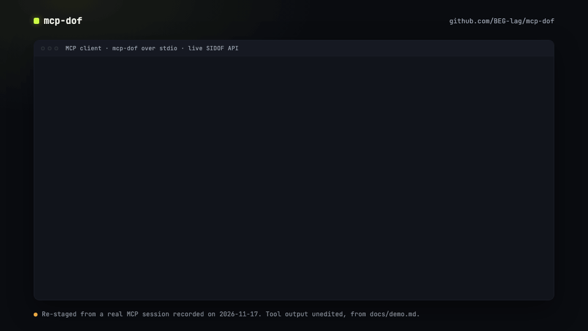
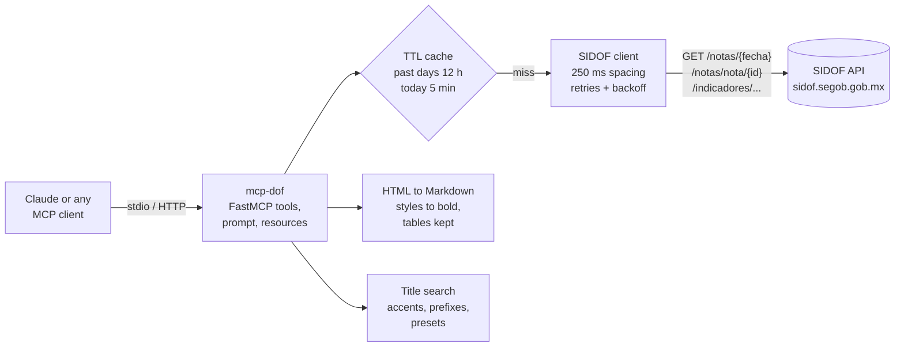

<p align="center">
  <a href="https://pivotek.mx"></a>
</p>

<p align="center">
  
</p>

<p align="center">
  <b>English</b> · <a href="README.es.md">Español</a>
</p>

<p align="center">
  <a href="https://github.com/BEG-lag/mcp-dof/actions/workflows/ci.yml"></a>
  
  
  
  <a href="https://registry.modelcontextprotocol.io/v0.1/servers?search=io.github.BEG-lag/mcp-dof"></a>
</p>

<!-- demo:start -->
<p align="center">
  
</p>
<p align="center"><sub>Re-staged from the real session in <a href="docs/demo.md">docs/demo.md</a>. <a href="assets/demo.mp4">MP4 version</a>.</sub></p>
<!-- demo:end -->

<!-- mcp-name: io.github.BEG-lag/mcp-dof -->

**mcp-dof** is a [Model Context Protocol](https://modelcontextprotocol.io) server that lets Claude
and other AI agents read Mexico's *Diario Oficial de la Federación* (DOF): what was published on any
day, the full text of every decree, rule or notice as clean Markdown, title search over date ranges,
and the exchange rate, UDIS and TIIE the DOF publishes daily.

The DOF is where Mexican federal law becomes law. Lawyers, compliance teams and analysts check it
every morning. This server lets an agent do the reading, always citing the official link.

## Demo

Real output, recorded through a real MCP client over stdio against the live API on 2026-11-17.
Excerpts below are copied verbatim (`…` marks omitted lines); the full, unedited transcript is in
[`docs/demo.md`](docs/demo.md).

```markdown
<!-- list_edition(date="2026-11-13") · 0.4 s -->
# DOF 2026-11-13 · Friday

66 notes in 2 edition(s): matutina, vespertina.
44 avisos judiciales y generales hidden (pass include_avisos=true to list them).

## Edición matutina · 61 notes (44 avisos hidden) · [edition PDF](https://sidof.segob.gob.mx/dof/sidof/documentos/pdf/330805)

**PODER EJECUTIVO › PRESIDENCIA DE LA REPUBLICA**
- `5803757` Decreto por el que se expide la Ley de Ingresos de la Federación para el Ejercicio Fiscal de 2027. · p. 4 · [DOF](https://dof.gob.mx/nota_detalle.php?codigo=5803757&fecha=13/11/2026)
…
```

```markdown
<!-- get_indicators(date="2026-11-17") · 0.2 s -->
| Indicator | Value | Unit | Published | Key |
| --- | --- | --- | --- | --- |
| Tipo de cambio FIX (dólar) | 18.5525 | MXN per USD | 2026-11-17 | `usd` |
| UDIS | 8.913896 | MXN per UDI | 2026-11-17 | `udis` |
| TIIE 28 días | 6.5147% | % annual | 2026-11-17 | `tiie28` |
| TIIE 91 días | 6.5492% | % annual | 2026-11-17 | `tiie91` |
| TIIE 182 días | 6.5995% | % annual | 2026-11-17 | `tiie182` |
| TIIE de fondeo | 6.26% | % annual | 2026-11-17 | `tiie_fondeo` |
…
```

`search_notes(practice_area="hidrocarburos", date_from="2026-10-01", date_to="2026-11-13")` scanned
44 days (535 notes) in 10.7 s with a cold cache and returned 32 matches, from the CNE rules on
marketing of natural gas and petroleum products to the ASEA emergency NOMs on LP gas.

Things you can ask once it is connected (example prompts, not recorded answers):

- *"¿Qué publicó el DOF hoy? Resume solo lo que toca energía e hidrocarburos."*
- *"Read the Ley de Ingresos 2027 and list every transitory article with a deadline."*
- *"Prepara un digest regulatorio de minería de las últimas dos semanas."* (uses the `regulatory_digest` prompt)
- *"How did the FIX exchange rate move in October 2026?"*

## Quickstart

You need [uv](https://docs.astral.sh/uv/). Nothing else: `uvx` downloads and runs the server.

**Claude Code**

```bash
claude mcp add dof -- uvx --from git+https://github.com/BEG-lag/mcp-dof mcp-dof
```

**Claude Desktop**: add this to `claude_desktop_config.json`
(macOS: `~/Library/Application Support/Claude/`, Windows: `%APPDATA%\Claude\`) and restart:

```json
{
  "mcpServers": {
    "dof": {
      "command": "uvx",
      "args": ["--from", "git+https://github.com/BEG-lag/mcp-dof", "mcp-dof"]
    }
  }
}
```

**Docker**: every release publishes a multi-arch image (linux/amd64, linux/arm64) to GitHub
Container Registry. In any client config, use `"command": "docker"` with these arguments:

```bash
docker run -i --rm ghcr.io/beg-lag/mcp-dof:1.0.0
```

**Any other MCP client**: run `mcp-dof` over stdio, or `mcp-dof --transport http --port 8000`
for streamable HTTP at `http://127.0.0.1:8000/mcp`.

The metadata for the [MCP Registry](https://registry.modelcontextprotocol.io) lives in
[`server.json`](server.json), under the name `io.github.BEG-lag/mcp-dof`.

## Tools

| Tool | What it does |
| --- | --- |
| `list_edition(date, edition, include_avisos)` | Table of contents of a day (matutina, vespertina, extraordinaria), grouped by issuing agency, with note codes, pages, official links and the edition PDF. On weekends and holidays it points to the latest edition. |
| `get_note(code, start, max_chars)` | Full text of a note as Markdown (bold, tables and links preserved) with a metadata table. Long instruments are paginated. |
| `search_notes(query, date_from, date_to, practice_area, edition, include_avisos, limit)` | Title search over up to 92 days, newest first, with progress notifications. Accent and case insensitive, prefix matching (`eléctric`), `"phrases"`, `a \| b` alternatives and acronyms (`CFE`, `ISR`). |
| `get_indicators(date)` | FIX exchange rate, UDIS, TIIE 28/91/182 and TIIE de fondeo for a date; weekends are completed with the latest publication of each indicator. |
| `get_indicator_history(indicator, date_from, date_to)` | One indicator over up to 400 days, with first, last, change, low and high. |

Practice-area presets for `search_notes`: `energia`, `hidrocarburos`, `mineria`, `fiscal`,
`ambiental`, `competencia`, `financiero`, `comercio_exterior`, `laboral`, `datos_personales`,
`normas`, `telecom`.

Also exposed: the prompt **`regulatory_digest(practice_area, date_from, date_to, language)`** and
the resources `dof://edition/{date}` (JSON), `dof://note/{code}` (Markdown) and
`dof://practice-areas`. Dates accept `YYYY-MM-DD`, `DD-MM-YYYY`, `today` or `yesterday`, in Mexico
City time. All tools are annotated read-only.

## How it works



The DOF has no official API documentation beyond a few PDFs, so the endpoints, quirks and limits
were probed by hand and written up in [`docs/api.md`](docs/api.md). A few highlights: a bare
`Accept: application/json` header gets HTTP 406, invalid dates return HTTP 500, every table of
contents mixes untitled separator rows with real notes, and the public search backend returns
HTTP 204 for every query, which is why `search_notes` scans daily indexes instead.

Being polite to a government server is part of the design: a descriptive `User-Agent`, at least
250 ms between requests, exponential backoff that honours `Retry-After`, timeouts, and caching.

## Project structure

```text
src/mcp_dof/
  server.py      FastMCP app: tools, resources, prompt, CLI entry point
  client.py      async SIDOF client: throttling, retries, TTL cache
  models.py      typed parsing of SIDOF payloads (editions, notes, indicators)
  markdown.py    note HTML to Markdown, pagination at paragraph boundaries
  search.py      query parser, accent-insensitive matching, practice-area presets
  formatting.py  Markdown rendering of tool results
  dates.py       date parsing and validation in Mexico City time
tests/           87 offline tests on recorded fixtures + 3 opt-in live tests
scripts/         record_fixtures.py, demo.py (writes docs/demo.md), smoke_stdio.py (handshake check)
docs/api.md      the SIDOF API, as observed
Dockerfile       container image published to ghcr.io/beg-lag/mcp-dof
server.json      MCP Registry metadata
```

## Development

```bash
uv sync
uv run pytest                 # offline: recorded SIDOF responses, no network
uv run pytest --live -m live  # opt in: hits the real API
uv run ruff check . && uv run ruff format --check .
uv run python scripts/demo.py # real MCP round trip over stdio
docker build -t mcp-dof . && uv run python scripts/smoke_stdio.py -- docker run -i --rm mcp-dof
```

CI runs ruff and the offline suite on Python 3.12, 3.13 and 3.14, validates `server.json` against
the official MCP Registry schema, and builds the container and checks its MCP handshake. Pushing a
`vX.Y.Z` tag publishes the image to GHCR. A separate weekly workflow runs the live tests, so a
change in the government API shows up as a failed check instead of a confused agent.

## Limitations

- **Search covers titles, not full text**, and at most 92 days per call: SIDOF's own search
  endpoint did not return results when probed. Scanning a cold range takes roughly 0.25 s per day.
- Avisos judiciales y generales are listed by SIDOF with reference codes as titles
  (`Aviso REF:581596`), so they are hidden by default and not searchable by content.
- Full text is available only when SIDOF has HTML for the note (its `existeHtml` flag). Otherwise
  `get_note` returns the metadata plus the Word and edition PDF links.
- The SIDOF API is undocumented and can change without notice; the weekly live check is the
  early warning.
- Indicators are listed by DOF publication date; Banco de México determines the FIX and the TIIE
  on the previous business day.

## Disclaimer

Unofficial: only the printed/official DOF is authoritative; not legal advice. This project is not
affiliated with the Secretaría de Gobernación or the DOF. Verify any legal conclusion against the
official publication and with the competent authority.

## Author

Built by **Benjamín Esponda García**, a Mexican corporate lawyer (energy, hydrocarbons and
mining) who builds with AI. More at [pivotek.mx](https://pivotek.mx) and in the
[portfolio](https://github.com/BEG-lag/portafolio-ia). Companion project:
[dof-diario](https://github.com/BEG-lag/dof-diario), a living open dataset of the DOF table of
contents.

Code released under the [MIT License](LICENSE).
